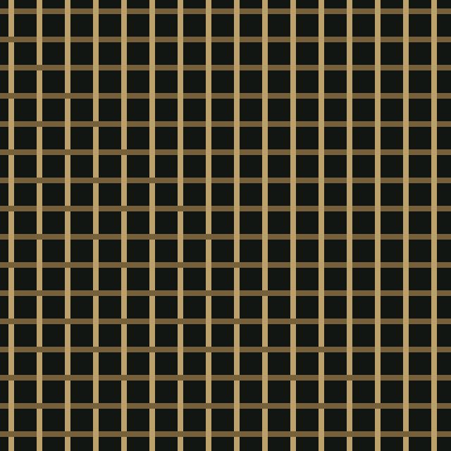
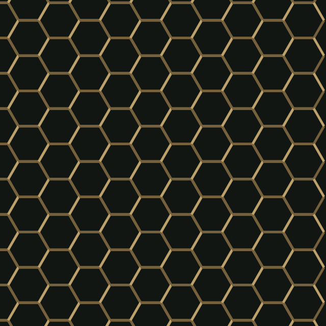
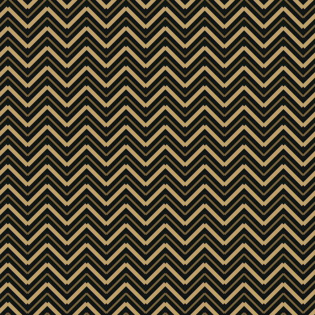
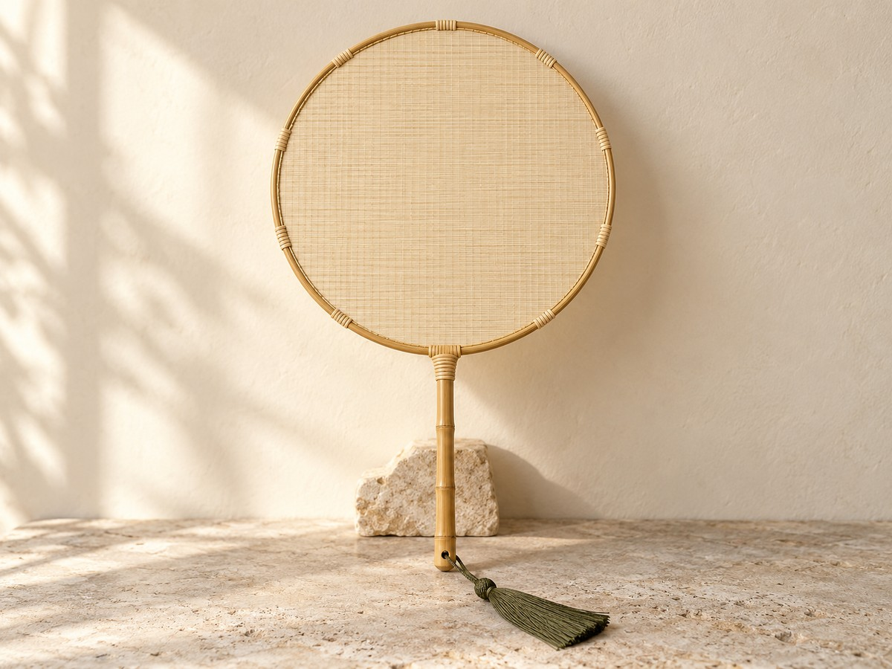
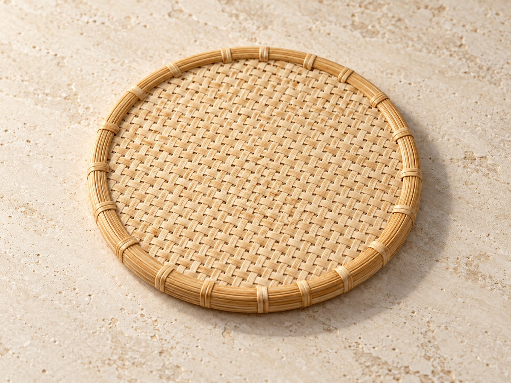
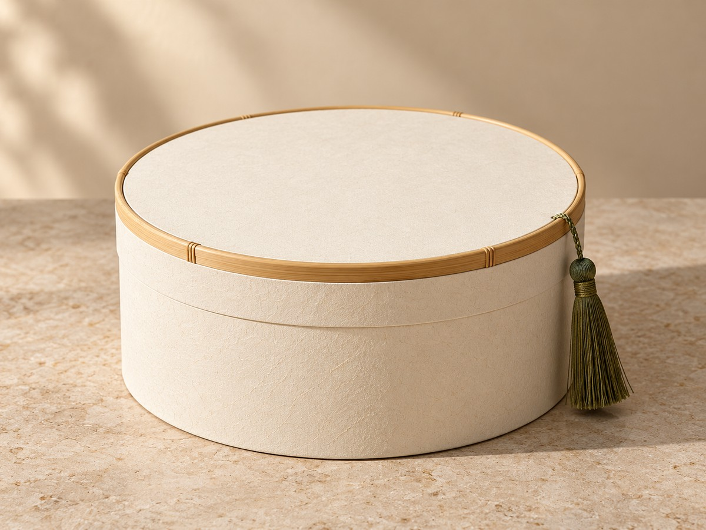

<div align="center">

# 竹序 ZHUXU
### 一经一纬，编织新生

让传统竹编从「被观看」走向「可参与」的数字设计工坊。

**[进入在线体验 ↗](https://zhuxu-bamboo-studio.bdjmcncfjbdjnc.chatgpt.site/) · [开始编织 ↗](https://zhuxu-bamboo-studio.bdjmcncfjbdjnc.chatgpt.site/#studio) · [查看源码](dist/)**

</div>


> 项目主视觉素材。下方展示的是站内纹样与产品样机素材，并非界面截图；实际交互可通过在线体验查看。

## 项目介绍

竹序是一款围绕传统竹编的浏览器端交互设计原型，将编织结构、东方配色与文创产品预览结合起来。用户可以从一种编法出发，调整纹样参数、尝试配色、逐根编辑竹条，再将设计应用到不同载体上，导出用于展示与交流的图形。

项目希望缩短从「理解工艺」到「表达设计」的距离：通过即时可见的反馈，让没有专业建模经验的用户也能探索经纬、疏密、挑压和色彩之间的关系。

**适合的使用场景：** 传统工艺体验、文创设计灵感探索、课堂演示与设计方案展示。

## 从灵感到作品

**认识编法 → 调整结构 → 尝试配色 → 局部编辑 → 预览载体 → 导出作品**

1. 在「纹样图谱」中认识编织语言，选择感兴趣的纹样。
2. 进入「数字工坊」，调整编织密度、竹篾宽度与横纵位移。
3. 使用预设配色，或上传图片提取颜色，再调整经线、纬线和底色。
4. 对竹条进行局部涂色，通过撤销继续尝试。
5. 在「造物新生」中查看纹样应用到不同产品载体的效果。
6. 导出 SVG 纹样或 PNG 效果图，用于作品交流与后续设计。

## 核心功能

| 模块 | 可以做什么 | 设计目的 |
| --- | --- | --- |
| 竹编之道 | 了解选竹、制篾、编织、收口等基础工序 | 为数字创作提供工艺语境 |
| 纹样图谱 | 浏览并选择不同编织结构 | 降低从空白开始设计的门槛 |
| 参数化纹样 | 调整密度、篾宽、位移与挑压相关设置 | 直观看到结构变化 |
| 配色探索 | 选择经典或现代配色、图片取色、自定义颜色 | 把个人灵感转化为色彩方案 |
| 局部编辑 | 对单根竹条涂色，撤销编辑 | 支持更细致的个性化表达 |
| 产品套样 | 将纹样应用到团扇、包袋、纸品等载体 | 观察平面纹样与物件之间的关系 |
| 保存与导出 | 本地保存方案，导出 SVG / PNG | 方便继续创作和分享设计结果 |

## 视觉预览

### 纹样探索

以下为项目内置的数字纹样示意。实际工坊支持进一步调整参数与颜色。

<table>
<tr>
<td align="center" width="33%"><br>纹样示例 01</td>
<td align="center" width="33%"><br>纹样示例 02</td>
<td align="center" width="33%"><br>纹样示例 03</td>
</tr>
</table>

### 文创载体

以下为站内使用的 **AI 生成产品样机底图**，展示可供数字纹样套用的产品方向；在线工坊中可查看动态套样效果。

<table>
<tr>
<td width="50%"><br><b>团扇</b> · 探索纹样在扇面上的视觉表达</td>
<td width="50%"><br><b>杯垫</b> · 观察纹样在小尺度器物上的效果</td>
</tr>
<tr>
<td><br><b>纸袋</b> · 尝试文创包装的图案应用</td>
<td><br><b>礼盒</b> · 预览纹样与包装载体的组合</td>
</tr>
</table>

## 产品设计思路

- **从文化内容进入创作。** 工艺介绍、纹样图谱与编辑器在同一体验路径中，帮助用户边看边试。
- **让调整立即可见。** 参数和颜色变化同步到预览，支持快速比较方案。
- **连接纹样与使用场景。** 通过产品套样，让用户进一步思考设计如何进入日常生活。
- **保留可带走的成果。** SVG 便于继续编辑，PNG 便于展示；本地保存方便返回继续尝试。

这些是原型的设计目标与实现方式，项目尚未提供正式用户研究、使用规模或商业转化数据。

## AI 与技术实现

项目的部分品牌视觉和产品样机通过 AI 生成，并保留了相应素材记录。运行中的纹样绘制、配色、局部编辑与导出由浏览器端代码完成，**不需要大模型 API 密钥，也不会在每次操作时请求远程 AI 生成**。

| 技术 | 用途 |
| --- | --- |
| HTML / CSS / 原生 JavaScript | 页面结构、视觉样式与交互逻辑 |
| SVG 参数化图形 | 编织纹样绘制与矢量导出 |
| Canvas / 浏览器图像能力 | 图片取色、编辑交互与 PNG 导出 |
| LocalStorage | 浏览器本地方案保存 |
| Node.js 内置 HTTP 模块 | 本地预览服务 |
| 静态托管 | 发布可直接访问的在线作品 |

## 本地运行

安装 Node.js 后：

```sh
git clone https://github.com/bdjmcncfjbdjnc-bit/zhuxu.git
cd zhuxu
node server.cjs
```

在浏览器打开 **http://localhost:4173**。网站运行无需安装前端依赖。

部署时将 `dist/` 作为静态网站根目录即可。在线版本：[竹序数字竹编工坊](https://zhuxu-bamboo-studio.bdjmcncfjbdjnc.chatgpt.site/)。

## 源码结构

```text
zhuxu/
├── dist/
│   ├── index.html          # 网站入口
│   ├── weave-engine.js     # 编织结构与纹样生成
│   ├── studio-v3.js        # 工坊控制与配色
│   ├── canvas-editor.js    # 局部编辑
│   ├── realism-v10.js      # 产品样机合成
│   ├── *.css / *.js        # 页面样式与其他交互
│   └── assets/             # 纹样、照片与生成素材
├── server.cjs              # 本地预览服务器
├── ASSETS.md / ASSET-*.md   # 素材出处与生成记录
├── QA-*                    # 原项目验证记录
└── test-*.cjs              # 原项目测试脚本
```

原项目测试脚本依赖原工作区的 QA 工具，当前仓库未捆绑这些测试依赖；QA 文档是历史验证记录，不代表当前环境已重新执行全部测试。

## 素材与项目边界

- 素材出处、生成记录和许可说明见 [ASSETS.md](ASSETS.md)、[v8](ASSET-v8.md)、[v9](ASSET-v9.md)、[v10](ASSET-v10.md)。
- 仓库公开用于项目展示和源码阅读，不等于授予所有图片与代码任意商用或再分发许可；使用前请核对对应授权。
- 数字纹样和产品套样属于设计原型；AI 样机不代表已生产实物，结构亦不能直接作为制造工艺依据。
- 保存方案依赖当前浏览器的本地存储，不提供账号云端同步。
- 本仓库基于现有 Sites 项目源码快照，源提交为 `2101fdca41fb6e349a5fa04945e0f4752e1b6355`。

---

<div align="center">

**以数字续写手艺，以设计连接生活。**

[开始你的第一件竹编设计 ↗](https://zhuxu-bamboo-studio.bdjmcncfjbdjnc.chatgpt.site/#studio)

</div>
